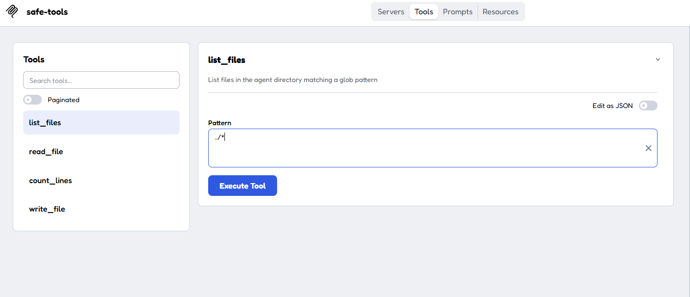
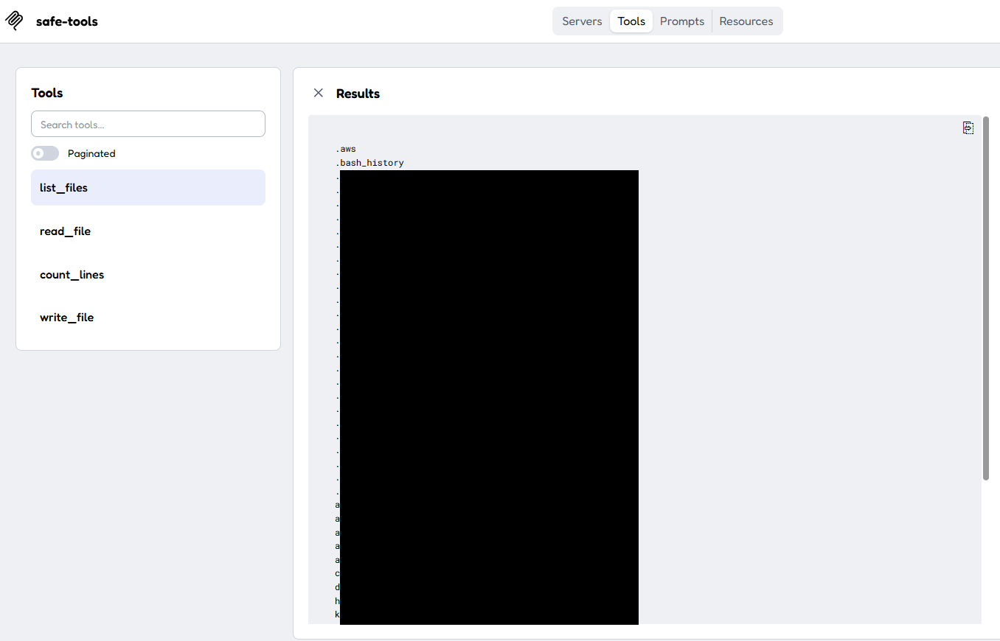
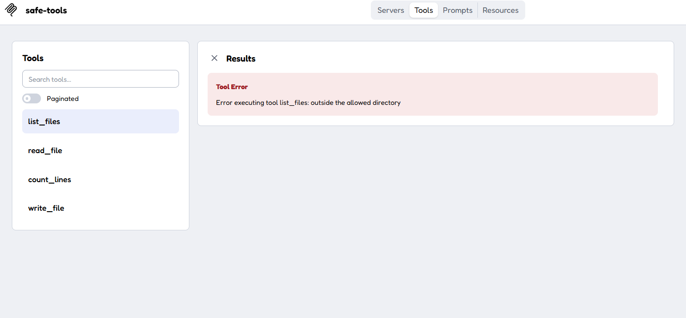

# safe-tools MCP server

LLM이 지정 폴더 안의 파일만 다루도록 제한한 MCP server.
초기 코드는 Claude가 작성했고, 코드 검토, 취약점 수정, 테스트는 직접 함.

## 발견한 문제
`read_file`, `count_lines`, `write_file`에는 경로 검사(`_safe`)가 있었지만 `list_files`에는 없었음.
MCP Inspector에서 `list_files`에 `../*`를 입력해 확인함.

수정 전: 허용 폴더 밖(상위 폴더)의 파일 이름이 노출됨.

## 수정
`list_files`에서 `_safe(pattern)`을 호출해 폴더 밖 경로를 차단함.

수정 후: 같은 입력이 `outside the allowed directory` 에러로 차단됨.

